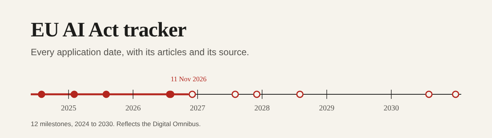

# eu-ai-act-tracker



[](https://github.com/pJijesh/eu-ai-act-tracker/actions/workflows/test.yml) [](LICENSE)  

**Problem:** the EU AI Act has no single go-live date. Its rules switch on in stages from 2024 to 2030, the Digital Omnibus has since moved several of them, and most summaries online either predate the change or do not say where each date comes from.

**For:** IT managers, heads of IT, compliance leads and architects who need to know what applies to their organisation, and by when, without reading the Regulation end to end.

**Demonstrates:** treating a regulatory timeline as data: every date carries its article numbers and a source link, a validator checks the data, and the Markdown timeline, the calendar file and the table below are all generated from one JSON file and checked in continuous integration so they cannot drift apart.

> This is a practitioner's index, not legal advice. Dates and articles come from the Regulation and its amendment as listed in each entry's sources. Confirm anything you rely on against the official text on EUR-Lex.

Last verified: 11 November 2026, against the sources listed in [`data/milestones.json`](data/milestones.json). The Digital Omnibus (Regulation (EU) 2026/1744) is in force and its dates are used throughout.

## Timeline

<!-- timeline:start -->
| Date | Status | What applies | Articles | Omnibus |
| --- | --- | --- | --- | --- |
| 1 August 2024 | in force | The AI Act enters into force | 113 | no change |
| 2 February 2025 | in force | Prohibited practices and AI literacy apply | 4, 5 | amended by the Omnibus |
| 2 August 2025 | in force | General-purpose AI obligations, governance and penalties apply | 51, 52, 53, 54, 55, 56, 78, 99 | no change |
| 27 July 2026 | in force | The Digital Omnibus on AI enters into force | 113 | added by the Omnibus |
| 2 August 2026 | in force | General application date: transparency duties and Commission enforcement over general-purpose AI | 50, 101 | no change |
| 2 December 2026 | in 21 days | Deadline for Article 50(2) marking on systems already on the market | 50, 111 | added by the Omnibus |
| 2 December 2026 | in 21 days | New Article 5 prohibitions apply | 5 | added by the Omnibus |
| 2 August 2027 | in 264 days | General-purpose AI models placed on the market before 2 August 2025 must comply | 53, 55, 111 | no change |
| 2 December 2027 | in 386 days | High-risk obligations apply to Annex III use cases | 6, 9, 10, 11, 12, 13, 14, 15, 16, 17, 26, 27 | moved by the Omnibus |
| 2 August 2028 | in 630 days | High-risk obligations apply to AI in Annex I regulated products | 6, 9, 10, 11, 12, 13, 14, 15, 16, 17 | moved by the Omnibus |
| 2 August 2030 | in 1360 days | High-risk systems for public authorities already on the market must comply | 111 | no change |
| 31 December 2030 | in 1511 days | AI components of large-scale IT systems must comply | 111 | no change |
<!-- timeline:end -->

The full entries, with summaries, roles and source links, are in [`docs/timeline.md`](docs/timeline.md). Add every date to a calendar with [`dist/ai-act-timeline.ics`](dist/ai-act-timeline.ics).

## What it does

- **Sourced milestones** (`data/milestones.json`): twelve dates from entry into force on 1 August 2024 to the last legacy deadline on 31 December 2030. Each has articles, the roles it affects, whether the Omnibus changed it, and at least one source.
- **Obligations by role** (`data/obligations.json`): a short index of the main duties for providers, deployers and providers of general-purpose AI models, with the three maximum-fine tiers from Article 99.
- **Calendar file** (`dist/ai-act-timeline.ics`): all-day events you can import into any calendar.
- **Command line tool** (`aiact`, standard library only):
  - `aiact next`: the next milestone, optionally for one role.
  - `aiact by-role deployer`: the dates and obligations for one role.
  - `aiact check`: validates the data and confirms the generated files are current. CI runs this.
  - `aiact build`: regenerates the timeline, the calendar and the table above.

## Quick start

Requires Python 3.10 or later. No third-party packages.

```bash
pip install -e .            # gives the aiact command; python -m aiact_tracker works from a checkout

aiact next                              # the next date from today
aiact next --role deployer --all        # every later date that affects deployers
aiact by-role gpai_provider             # dates and obligations for model providers
aiact check                             # data valid, generated files current
```

Roles are `provider`, `deployer`, `gpai_provider` and `member_state`.

## How it is built

```text
.
├── data/
│   ├── milestones.json      Dates, articles, roles, Omnibus status and sources
│   └── obligations.json     Obligations by role, and the Article 99 fine tiers
├── aiact_tracker/
│   ├── data.py              Loading and validation
│   ├── render.py            Markdown and iCalendar output
│   └── cli.py               next, by-role, check and build
├── docs/timeline.md         Generated
├── dist/ai-act-timeline.ics Generated
├── tests/
└── .github/workflows/test.yml
```

## Design choices

- **One source of truth.** Everything shown is generated from the two JSON files, and `aiact check` fails if a generated file is stale.
- **No clock in the committed files.** Statuses in the generated table are measured from the `as_of` date in the data, so the same data always gives the same bytes. The `next` command is the only thing that reads today's date.
- **Sources on every date.** A milestone with no source, or a source that is not an HTTPS link, fails validation.
- **Say what changed.** Each date is marked as unchanged, amended, moved or added by the Omnibus, because that is the question most readers are really asking.
- **Small on purpose.** It indexes obligations and points to articles. It does not interpret them or tell you whether your system is high risk; for that, see the companion [eu-ai-act-risk-classifier](https://github.com/pJijesh/eu-ai-act-risk-classifier).

## Limitations

- It is an index, not an interpretation. Whether an obligation applies to a particular system or organisation depends on facts this tool does not know.
- The obligation summaries are short paraphrases. They omit exceptions, thresholds and cross-references that matter in practice.
- The fine tiers are the maximum figures in Article 99. Actual fines depend on the case, and reduced limits apply to small and medium-sized enterprises. Check the consolidated text.
- Several sources are the consolidated text in the unofficial AI Act Explorer rather than the Official Journal itself. Where the two could differ, the Official Journal text governs.
- National rules and guidance from regulators are out of scope, as are standards, codes of practice and Commission guidelines.
- The data is a snapshot. Dates have moved once already and could move again; the last-verified date above says how fresh it is.

## Verification status

- Every date was read from the sources listed in `data/milestones.json` on 11 November 2026, and the entries that rely on Article 111 transitions were read from the consolidated Article 111 text.
- The tests cover the loader and validator (including each way the data can be wrong), the Markdown and calendar output, calendar line folding and escaping, the command line, a check that the committed generated files equal a fresh build, and repository hygiene (no long dashes, working links).
- The calendar file has been generated and parsed by the tests' own checks, not imported into a specific calendar application.
- The obligations index and the fine tiers are a summary from the Regulation and were not reviewed by a lawyer.
- It was run on Python 3.13 here. The CI matrix covers 3.10 to 3.13 and was not run from this environment.

## Roadmap

Planned, not promised.

- **Next:** Recheck every date after 2 December 2026
- **Then:** Add the Commission guidelines and codes of practice as optional sourced entries
- **Later:** A JSON feed of upcoming milestones

## Licence

[MIT](LICENSE), 2026 Puliyappottammal Jijesh. See [CONTRIBUTING](CONTRIBUTING.md) for how to report a changed date.

Built by [Puliyappottammal Jijesh](https://www.linkedin.com/in/pjijesh), an IT manager. [GitHub](https://github.com/pJijesh)
